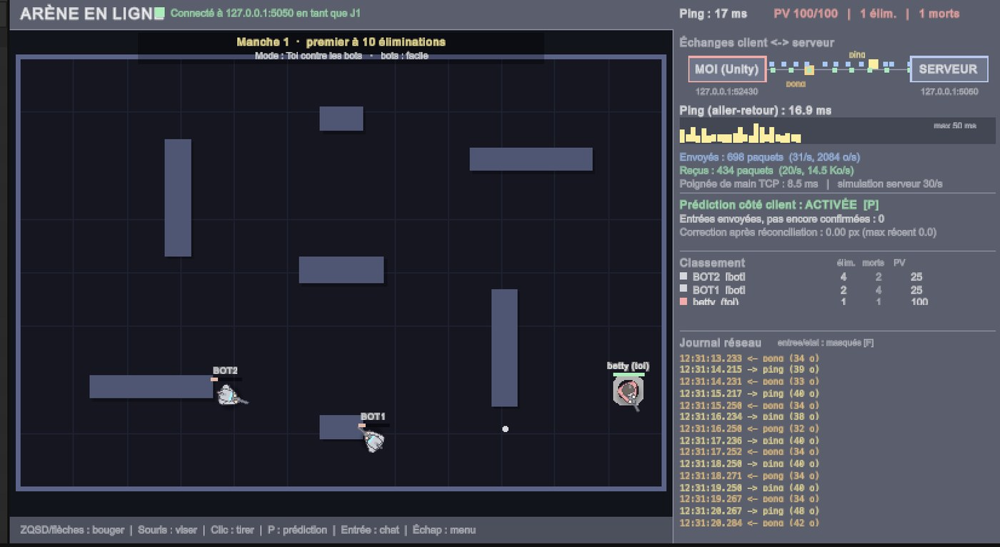
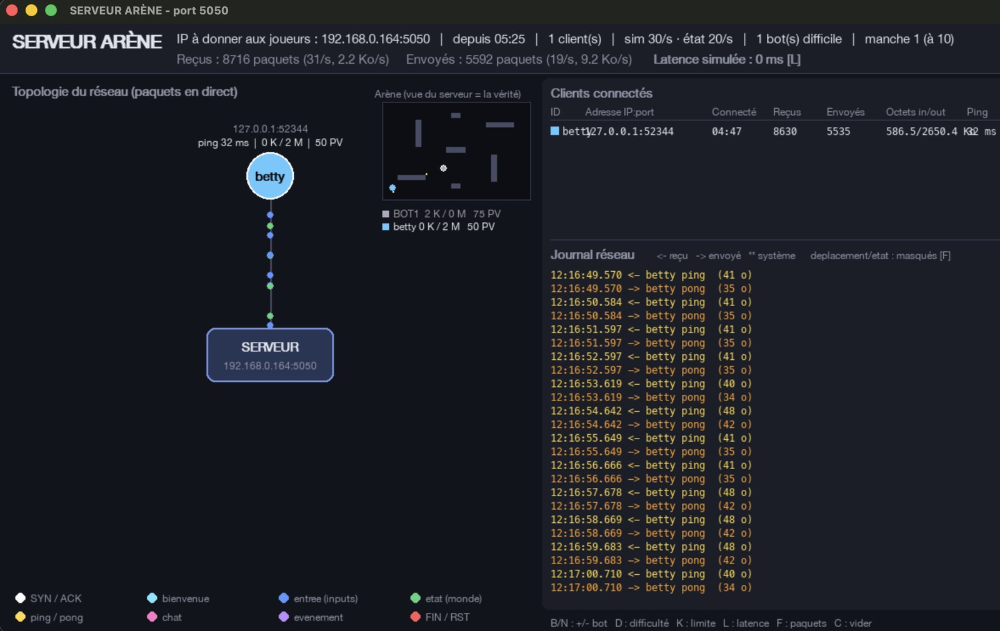
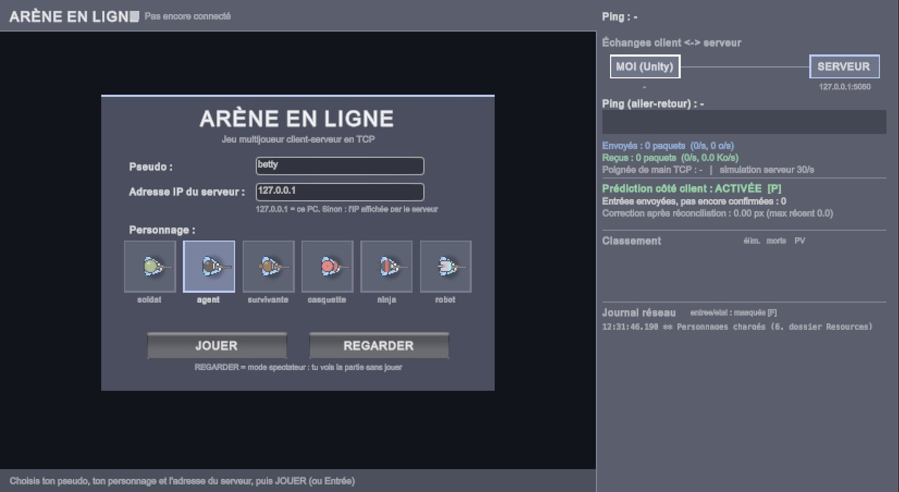
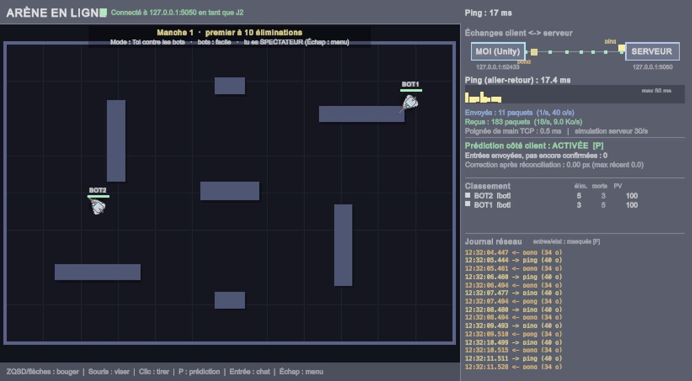
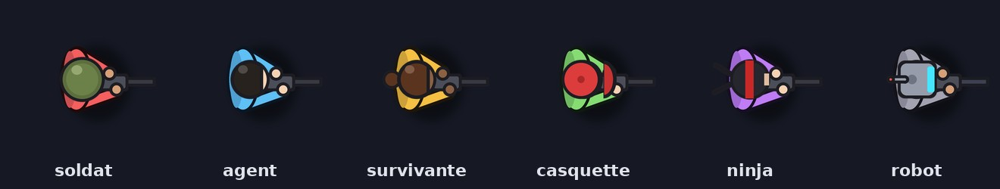

# Arène en ligne : jeu multijoueur client-serveur (Unity + Python)

Projet du module **Réseau et backend du jeu**. C'est une simulation de connexion **client-serveur en TCP**, sous la forme d'un vrai petit jeu multijoueur : une arène de tir vue de dessus, avec des personnages, des bots, des manches et un chat.

- **Serveur** en Python (Pygame) : il simule tout le jeu (il fait autorité) et affiche un **tableau de bord réseau** en direct (topologie, paquets, poignée de main TCP, journal, débit, latence simulée).
- **Client** dans Unity (C#) : prédiction côté client, réconciliation, interpolation, et un panneau réseau (ping, paquets, journal).

## Aperçu

**Le jeu (client Unity)** : l'arène, les personnages, les bots, et à droite le panneau réseau (échanges client ↔ serveur, ping, paquets, prédiction, journal).



**Le serveur (Python)** : le tableau de bord réseau en direct. On y voit la topologie avec les paquets qui circulent, l'arène telle que le serveur la voit, les clients connectés et le journal de tous les messages.



| Menu de départ | Mode spectateur |
|---|---|
|  |  |
| Pseudo, adresse IP du serveur, choix du personnage | Le client ne fait que recevoir l'état du jeu (18 paquets/s reçus, 1 paquet/s envoyé) |

**Les 6 personnages** (la tenue prend la couleur du joueur) :



## Contenu du dépôt

| Dossier / fichier | Rôle |
|---|---|
| `Serveur/serveur_arene.py` | Serveur du jeu (arène, bots, modes, manches) |
| `Serveur/serveur.py` | Base du serveur : réseau TCP, threads, tableau de bord |
| `Serveur/commun.py` | Code partagé : encodage des messages, animations |
| `Serveur/client.py` | Premier client simple en Pygame (pour `serveur.py`) |
| `Assets/ClientArene.cs` | Client Unity (le jeu) |
| `Assets/Resources/Personnages/` | Images des personnages |
| `Captures/` | Captures d'écran de ce README |

## Démarrage rapide

**1. Le serveur** (Python 3 + Pygame) :
```
cd Serveur
python3 -m venv venv
source venv/bin/activate          # Windows : venv\Scripts\activate
pip install pygame
python serveur_arene.py
```

**2. Le client** : ouvrir le dossier du dépôt avec **Unity 6** (Unity Hub → Add → Add project from disk), puis appuyer sur **Play**. On peut aussi télécharger le jeu compilé dans les **Releases** du dépôt.

**3. Dans le menu du jeu**, entrer l'adresse IP affichée en haut de la fenêtre du serveur (`127.0.0.1` sur le même PC), choisir un pseudo et un personnage, puis cliquer sur **JOUER** (ou **REGARDER** pour être spectateur).

**Touches du serveur :** M = mode de jeu, B/N = ajouter/retirer un bot, D = difficulté des bots, K = limite d'éliminations, L = latence simulée, F = afficher les paquets fréquents.

---

# Simulation client-serveur : jeu multijoueur en réseau (Python + Pygame + TCP)

Chaque joueur déplace un carré et ramasse des pièces. On voit en direct tout ce qui passe sur le réseau, dans la fenêtre du serveur comme dans celle des clients.

## Fichiers

| Fichier | Rôle |
|---|---|
| `commun.py` | Réglages communs (port, tick rate), encodage des messages, animation des paquets |
| `serveur.py` | Le serveur et son **tableau de bord réseau** |
| `client.py` | Le jeu et son **panneau réseau** |

Les trois fichiers doivent être dans le même dossier.

## Lancement

```
source venv/bin/activate        (sur Mac, dans chaque terminal)
python serveur.py               (terminal 1)
python client.py                (terminal 2)
python client.py                (terminal 3)
```

Sur plusieurs PC du même Wi-Fi : `python client.py 192.168.x.x`, avec l'IP du PC qui fait tourner le serveur.

## Ce qu'on voit

### Fenêtre du serveur
- **La topologie** : le serveur au centre et les clients autour, reliés par un câble. Chaque message est un **point coloré qui voyage** sur le câble.
- **La poignée de main TCP animée** à chaque connexion (SYN → SYN-ACK → ACK), puis le message `bienvenue`.
- **La déconnexion animée** (FIN ou RST) : le client disparaît.
- **Le tableau des clients** : adresse IP:port, durée de connexion, paquets et octets reçus/envoyés, ping.
- **Le journal réseau** avec l'heure à la milliseconde près, le sens, le type de message et sa taille en octets.
- **Les statistiques** : paquets par seconde et débit en Ko/s.
- **L'état du jeu vu par le serveur** (mini-carte) : c'est le serveur qui fait autorité.

### Fenêtre du client
- Le jeu : ramasse les pièces jaunes, et appuie sur **Entrée** pour écrire dans le chat (une bulle apparaît au-dessus de ton carré).
- L'animation des paquets envoyés et reçus entre « MOI » et « SERVEUR ».
- **Le ping** (temps d'aller-retour) mesuré chaque seconde, avec son graphique.
- Les paquets, les octets et le débit montant et descendant.
- Le temps de la poignée de main TCP et le port local choisi par le système.
- Le journal de tous les messages.

### Touches
| Où | Touche | Effet |
|---|---|---|
| Serveur | **L** | Latence simulée : 0 → 100 → 250 → 500 ms |
| Serveur / client | **F** | Afficher ou masquer les messages fréquents (`deplacement`, `etat`) dans le journal |
| Serveur | **C** | Vider le journal |
| Client | Flèches / Entrée | Bouger / chat |
| Client | **R** | Se reconnecter après une coupure |

## Le protocole (messages JSON, un par ligne)

| Sens | Type | Contenu | Fréquence |
|---|---|---|---|
| S → C | `bienvenue` | id, nom, couleur, position de départ | 1 fois |
| C → S | `deplacement` | x, y | max 20/s, seulement si le joueur bouge |
| S → tous | `etat` | tous les joueurs + la pièce | 20/s (**tick rate**) |
| C → S | `ping` | heure d'envoi | 1/s |
| S → C | `pong` | renvoie l'heure, ce qui permet de calculer le ping | 1/s |
| C → S | `chat` | texte | à la demande |
| S → tous | `chat` | auteur + texte | à la demande |
| S → tous | `evenement` | « J2 a rejoint la partie », « J1 a ramassé une pièce »… | à la demande |

## Notions à expliquer pendant la présentation

1. **TCP et UDP** : TCP est fiable et garde l'ordre des messages, c'est ce qu'on utilise ici. UDP est plus rapide mais sans garantie. Un FPS l'utiliserait pour les positions, parce qu'une position perdue n'est pas grave (la suivante arrive 50 ms plus tard).
2. **La poignée de main TCP** : faite par le système pendant `connect()` / `accept()`. Le serveur la montre au ralenti, et le client affiche sa vraie durée (moins de 1 ms en local).
3. **Le découpage des messages** : TCP est un *flux* d'octets, donc chaque message se termine par `\n` pour savoir où il s'arrête (voir `LecteurMessages` dans `commun.py`).
4. **Les threads** : un thread pour accepter les connexions, puis deux par client (réception et envoi). Les threads réseau passent les messages à la boucle du jeu par une `queue.Queue`, donc la logique du jeu tourne dans un seul thread et n'a jamais besoin de verrous.
5. **Le tick rate** : le serveur envoie l'état du jeu 20 fois par seconde, pas à chaque mouvement. C'est ce que font les vrais serveurs de jeu.
6. **Le serveur fait autorité** : c'est lui qui borne les positions, détecte qu'une pièce est ramassée et compte les scores. Le client ne peut pas tricher en envoyant `x=99999`.
7. **Le ping (RTT)** : le client envoie l'heure, le serveur la renvoie, et on mesure l'aller-retour.
8. **La latence** : appuie sur **L** dans le serveur. Le ping grimpe et les autres joueurs se déplacent avec du retard. Ton propre carré reste fluide, parce que le client l'affiche tout de suite sans attendre le serveur (*prédiction côté client*). Les autres joueurs glissent vers leur nouvelle position au lieu de sauter (*interpolation*).
9. **Les déconnexions** : une fermeture propre envoie un FIN, une coupure brutale un RST. Les deux sont gérées et annoncées à tous les joueurs.

## Démo suggérée (5 à 7 minutes)

1. Lancer le serveur et montrer le tableau de bord vide.
2. Lancer le client 1 et montrer l'animation SYN / SYN-ACK / ACK, puis `bienvenue`.
3. Lancer le client 2 et montrer qu'il apparaît chez tout le monde.
4. Bouger et ramasser des pièces : montrer les points bleus (`deplacement`) et verts (`etat`), puis appuyer sur **F** pour voir passer chaque paquet dans le journal.
5. Envoyer un message dans le chat (Entrée).
6. Appuyer sur **L** (500 ms) : montrer le ping qui monte et le retard des autres joueurs, puis remettre à 0.
7. Fermer le client 2 : animation FIN, et le joueur disparaît chez l'autre.
8. Arrêter le serveur : le client affiche « Déconnecté ». Relancer le serveur, puis appuyer sur **R** dans le client pour se reconnecter.
9. Bonus Wireshark : interface *Loopback*, filtre `tcp.port == 5050`, puis clic droit → *Follow TCP Stream* pour lire les messages JSON en clair.

## Bonus : client Unity (C#) sur le même serveur Python

Le fichier `unity/ClientReseau.cs` est un client Unity qui parle **exactement le même protocole** (TCP + JSON + `\n`). Un joueur Unity et un joueur Pygame peuvent donc jouer ensemble sur le même `serveur.py`.

**Installation :** glisser `ClientReseau.cs` dans le dossier *Assets* d'un projet Unity 2D, lancer `serveur.py`, puis appuyer sur **Play** dans Unity. Le script se crée tout seul dans la scène.

**Points à expliquer :**
- **Le protocole ne dépend pas du langage** : le serveur ne sait pas si le client est écrit en Python ou en C#, il reçoit juste des octets.
- **Le même modèle de threads** : un thread réseau lit la socket et passe les messages au thread principal par une `ConcurrentQueue`. Dans Unity, c'est obligatoire, car on ne peut toucher aux objets de la scène que depuis le thread principal.
- **Un piège classique** : sur un Mac en français, C# écrit `3,14` au lieu de `3.14`, ce qui casse le JSON. On utilise donc `CultureInfo.InvariantCulture` pour tous les nombres.
- **`JsonUtility` de Unity ne lit pas les dictionnaires**, d'où le petit lecteur JSON `MiniJson` à la fin du fichier.

---

# Le jeu final : ARÈNE DE TIR EN LIGNE

`serveur_arene.py` (Python) + `unity/ClientArene.cs` (Unity). C'est un vrai jeu multijoueur : on se déplace, on vise à la souris, on tire, les balles font des dégâts, on élimine les autres et on réapparaît 3 secondes plus tard.

## Lancement
1. `python serveur_arene.py` (il a besoin de `serveur.py` et `commun.py` dans le même dossier)
2. Unity : glisser `ClientArene.cs` dans *Assets* (un seul fichier : les images des personnages sont incluses dedans). Supprimer `ClientReseau.cs` s'il y est encore. Ensuite, **Play**.
3. Dans le menu, choisis ton pseudo, ton personnage et l'adresse du serveur (`127.0.0.1` si le serveur tourne sur ce PC), puis clique sur **JOUER**.
4. Pour avoir des adversaires : appuie sur **B** dans la fenêtre du serveur pour ajouter des bots (**N** pour en retirer).
   La touche **D** change leur difficulté : **facile** (par défaut), **moyen** ou **difficile**. En facile, le bot vise mal, tire rarement et bouge plus lentement.
5. **Modes de jeu** (touche **M** dans la fenêtre du serveur) :
   - **Toi contre les bots** (au démarrage) : 2 bots, les joueurs connectés jouent contre eux.
   - **Entre amis** : aucun bot, seulement les joueurs connectés (pour jouer avec tes collègues).
   - **Démo : les bots entre eux** : 4 bots s'affrontent, et les joueurs connectés regardent en spectateurs. C'est pratique pour présenter le tableau de bord réseau sans avoir à jouer.

   Dans le menu du jeu, le bouton **REGARDER** permet aussi d'entrer en **spectateur** quel que soit le mode : on reçoit l'état du jeu sans rien envoyer d'autre que le ping. **Échap** ramène au menu, ce qui ferme proprement la connexion (FIN).
6. **Mode match :** le premier à 10 éliminations gagne la manche. Un écran de victoire s'affiche, puis une nouvelle manche démarre. La touche **K** du serveur change la limite (10, 5, 20 ou sans limite).

## Jouer à plusieurs sur différents PC
1. **Même réseau :** tous les PC doivent être sur le même Wi-Fi. Si le Wi-Fi de l'école bloque la connexion, utilise le **partage de connexion d'un téléphone**.
2. **PC serveur :** lance `python serveur_arene.py`. L'adresse à donner aux autres s'affiche en haut de la fenêtre (« IP à donner aux joueurs : 192.168.x.x »). Si macOS demande d'*accepter les connexions entrantes* pour Python, clique sur **Autoriser**.
3. **Créer le jeu pour tes collègues** (ils n'ont pas besoin d'installer Unity) :
   - (conseillé) *Edit → Project Settings → Player → Resolution and Presentation → Fullscreen Mode : Windowed*
   - *File → Build Profiles* → **macOS** (ou **Windows** si tes collègues sont sur PC : il faut d'abord ajouter le module *Windows Build Support* dans Unity Hub → Installs → Manage → Add modules) → **Build**
   - envoie le dossier obtenu (zippé) par AirDrop, Drive, etc.
   - sur Mac, si le jeu reçu est bloqué : clic droit → **Ouvrir**, ou dans le terminal `xattr -cr NomDuJeu.app`
4. **Chaque joueur** lance le jeu, tape l'**IP du serveur** dans le menu, choisit son pseudo et son personnage, puis clique sur **JOUER**.
5. Le PC serveur peut aussi jouer : Unity (Play) ou le jeu compilé, avec l'adresse `127.0.0.1`.

**Commandes :** ZQSD / flèches = bouger, souris = viser, clic gauche ou Espace = tirer, **P** = prédiction ON/OFF, Entrée = chat.

## Architecture (ce qui rend le jeu « comme un vrai jeu en ligne »)

```
CLIENT UNITY                                   SERVEUR PYTHON (fait autorité)
 lit clavier/souris                             
 ── "entree" #42 (dx, dy, angle, tir) ──────▶   met l'entrée dans une file
 PRÉDIT sa position tout de suite                simule 30x/s : déplacements, murs,
 (même fonction Deplacer que le serveur)         balles, dégâts, éliminations
 ◀────────── "etat" 20x/s (tous les joueurs, ── 
             balles, PV, scores, seq traité)    
 RÉCONCILIE : repart de la position du serveur, 
 rejoue les entrées > seq pas encore traitées   
```

| Message | Sens | Fréquence | Rôle |
|---|---|---|---|
| `bienvenue` | S → C | 1 fois | id + **règles du jeu** (taille de l'arène, murs, vitesse, tick) |
| `profil` | C → S | 1 fois | pseudo et personnage choisis (vérifiés par le serveur) |
| `entree` | C → S | 30/s | touches + angle de visée + tir, numérotées (`seq`) |
| `etat` | S → tous | 20/s | position, angle, PV et personnage de chaque joueur, balles, manche en cours, et le dernier `seq` traité |
| `evenement` | S → tous | à la demande | arrivée, départ, élimination (« J1 a éliminé BOT2 »), fin de manche, nouvelle manche |
| `ping` / `pong` | C ↔ S | 1/s | mesure du temps d'aller-retour |
| `chat` | C ↔ S | à la demande | messages |

## Notions à présenter (avec démonstration)

1. **Le serveur fait autorité.** Le client envoie ses intentions, jamais sa position. Le serveur vérifie tout : collisions, cadence de tir, dégâts. Un tricheur ne peut pas se téléporter.
2. **Le tick rate.** La simulation tourne à 30 pas par seconde, toujours de la même durée, et l'état est envoyé 20 fois par seconde. Ce sont des réglages qu'on retrouve dans tous les jeux en ligne.
3. **La prédiction côté client.** Le client utilise **le même code** que le serveur (`deplacer()` en Python, `Deplacer()` en C#) pour bouger tout de suite, sans attendre la réponse.
4. **La réconciliation.** Chaque `etat` indique le dernier `seq` traité par le serveur. Le client repart de cette position et rejoue les entrées pas encore traitées. Le panneau affiche le nombre d'entrées en attente et la correction (environ 0 px quand tout va bien).
5. **L'interpolation et l'extrapolation.** Les autres joueurs glissent vers leur dernière position reçue. Les balles avancent selon leur vitesse entre deux états.
6. **⭐ La démo clé, l'effet de la latence :**
   - dans le serveur, appuie sur **L** jusqu'à 250 ou 500 ms ;
   - dans Unity, avec la prédiction **activée**, ton joueur reste fluide et les entrées en attente s'accumulent dans le panneau ;
   - appuie sur **P** pour désactiver la prédiction : ton joueur réagit maintenant avec un retard bien visible. C'est exactement le problème que la prédiction résout.
7. **Les bots** sont simulés par le serveur, sans connexion réseau. Ils apparaissent dans l'état du jeu, mais pas dans la topologie réseau, ce qui montre bien la différence entre une entité du jeu et un client connecté.
